# Smart Courier — 55 Relational Table Viva & Teacher Demonstration Guide

**Project:** Smart Courier & Parcel Delivery Management System  
**Framework:** Flask 3.0.3, SQLAlchemy 2.0 (ORM), Jinja2, Bootstrap 5  
**Database Relational Scope:** Exactly 55 SQLAlchemy business tables with full lifecycle auditing  
**Coverage Level:** 100% (55/55 tables populated with interconnected demonstration records)  
**Safety Certification:** Non-destructive, idempotent, isolated demo records (`VIVA2026`), zero external SMS/payment side-effects

---

## 1. Executive System Architecture

Smart Courier is an enterprise-grade parcel delivery and logistics management platform engineered in Python and Flask. The relational architecture consists of **55 normalized relational tables** mapped across seven core logistics domains. Every business entity inherits from `AuditMixin`, ensuring full auditing: primary keys (`id`), timestamps (`created_at`, `updated_at`), actor tracking (`created_by`, `updated_by`), status flags (`status`), and enterprise soft-deletion (`is_deleted`, `deleted_at`, `deleted_by`).

```
+-----------------------------------------------------------------------------------+
|                           SMART COURIER ARCHITECTURE                              |
+-----------------------------------------------------------------------------------+
| 1. Authentication & RBAC (6 tables)    -> Identity, 9 roles, permissions, sessions|
| 2. Organization & Network (6 tables)   -> Branches, sorting hubs, service zones   |
| 3. Customers & Catalog (10 tables)     -> Accounts, contacts, address book, rates |
| 4. Shipments & Booking (8 tables)      -> Parcels, items, quotes, docs, pickups   |
| 5. Dispatch & Fleet (11 tables)        -> Routes, stops, linehaul, proofs, fleet  |
| 6. Finance & Settlement (8 tables)     -> Invoices, payments, COD, refunds, promo |
| 7. Support & Auditing (6 tables)       -> Tickets, messages, in-app alerts, audit |
+-----------------------------------------------------------------------------------+
```

---

## 2. Seven Domain Groups (All 55 Tables)

### Group A: Authentication & Access Control (6 Tables)
1. **`users`**: Master user login identities, bcrypt password hashes, and profile metadata.
2. **`roles`**: Enterprise RBAC roles (`SUPER_ADMIN`, `BRANCH_MANAGER`, `HUB_OPERATOR`, `DISPATCHER`, `DRIVER`, `CUSTOMER`, `FINANCE_OFFICER`, `SUPPORT_AGENT`, `AUDITOR`).
3. **`permissions`**: Granular capability permissions (e.g., `shipments.create`, `dispatch.route`).
4. **`user_roles`**: Many-to-many junction assigning roles to users.
5. **`role_permissions`**: Many-to-many authorization matrix granting capabilities to roles.
6. **`login_sessions`**: Audit records of user authentication sessions. Seeded with an expired, revoked, inert row (`127.0.0.1 (VIVA_AUDIT)`) to prove session modeling without security vulnerability.

### Group B: Organization & Employees (6 Tables)
7. **`branches`**: Physical facilities operating in major economic hubs (Lahore Central, Karachi Port, Islamabad Branch).
8. **`hubs`**: Regional sorting centers handling inter-city freight consolidation (Lahore Sorting Hub, Karachi Hub, Islamabad Hub).
9. **`employees`**: Staff profiles linked to user accounts with employment IDs and job titles.
10. **`employee_branches`**: Employment duty allocations linking staff to operational branches.
11. **`service_zones`**: Postal geographic delivery zones (`ZONE-LHR`, `ZONE-KHI`, `ZONE-ISB`).
12. **`branch_zones`**: Coverage junction matrix specifying pickup and delivery eligibility between branches and zones.

### Group C: Customers & Catalog (10 Tables)
13. **`customers`**: Customer master records (`Apex Viva Merchant Ltd`, `Zenith Viva Logistics`).
14. **`customer_contacts`**: Designated secondary contacts (e.g., Bilal Tariq in Accounts, Ayesha Siddiqui in Warehouse).
15. **`customer_addresses`**: Saved pickup warehouses and business locations.
16. **`recipient_profiles`**: Frequent consignee address book profiles.
17. **`recipient_addresses`**: Saved physical delivery addresses for consignee profiles.
18. **`service_types`**: Delivery speed tiers (`STANDARD`, `EXPRESS`, `OVERNIGHT`).
19. **`parcel_categories`**: Parcel classification tariffs (`DOC`, `PARCEL`, `ELEC`, `CLOTH`, `FRAGILE`).
20. **`packaging_types`**: Standard courier packaging materials (`FLYER_S`, `BOX_M`, `WOOD_CRATE`).
21. **`rate_cards`**: Lane-by-service tariff cards connecting origin and destination zone pairs.
22. **`rate_card_rules`**: Weight-tier pricing rules defining base charges and incremental per-kg rates in integer paisa.

### Group D: Shipments & Booking (8 Tables)
23. **`shipments`**: Core parcel consignment records with unique tracking numbers, status, and weight.
24. **`shipment_items`**: Line item contents, item descriptions, and declared values.
25. **`shipment_addresses`**: Immutable point-in-time snapshots of sender and recipient contact/address information.
26. **`shipment_services`**: Frozen price quotation snapshot calculated by `PricingService` at booking.
27. **`shipment_documents`**: Genuine openable PDF waybills and manifests stored securely on disk.
28. **`pickup_requests`**: Doorstep parcel collection orders requested by senders.
29. **`pickup_assignments`**: Dispatch assignments allocating courier driver and vehicle to pickup requests.
30. **`shipment_status_history`**: Strict chronological audit trail enforcing valid state transitions.

### Group E: Dispatch, Fleet & Tracking (11 Tables)
31. **`routes`**: Planned courier delivery manifests and dispatch runs (`ROUTE-LHR-EAST-01`).
32. **`route_stops`**: Sequential delivery and pickup itinerary stops assigned to courier routes.
33. **`hub_transfers`**: Inter-hub linehaul freight container handoffs (`Lahore Hub` &rarr; `Karachi Hub`).
34. **`shipment_scans`**: Operational barcode scans logged at hubs and facilities.
35. **`tracking_events`**: Public customer tracking milestones displayed chronologically on `/tracking/<tn>`.
36. **`delivery_attempts`**: Field delivery attempts logged by drivers (`SUCCESS`, `FAILED`, `RESCHEDULED`).
37. **`delivery_proofs`**: Electronic Proof of Delivery (EPOD) capturing recipient signature and timestamp.
38. **`delivery_exceptions`**: Operational exception logs on failed attempts with documented resolution.
39. **`vehicles`**: Fleet assets (Motorcycles, Vans) with cargo capacity in grams.
40. **`drivers`**: Licensed courier drivers linked to employee records.
41. **`vehicle_assignments`**: Vehicle and driver associations assigned to specific delivery routes.

### Group F: Finance, COD & Promotions (8 Tables)
42. **`invoices`**: Commercial billing invoices issued per consignment with itemized totals.
43. **`invoice_items`**: Line items detailing freight charges, packaging, and applied discounts.
44. **`payments`**: Settled financial transaction records linked to invoices.
45. **`cod_collections`**: Doorstep Cash-on-Delivery cash collected by couriers upon successful delivery.
46. **`cod_remittances`**: Cashier reconciliation and remittance of collected COD funds to merchants.
47. **`refunds`**: Formal refund and courtesy adjustment requests (`PENDING`) linked to settled payments.
48. **`discounts`**: Promotional discount voucher codes (`VIVA2026` 10% promotional campaign).
49. **`shipment_discounts`**: Relational junction connecting applied discount codes to shipment billing.

### Group G: Support, Notifications & System Audit (6 Tables)
50. **`support_tickets`**: Customer inquiries and parcel delivery cases (`TICK-VIVA-01`, `TICK-VIVA-02`).
51. **`ticket_messages`**: Threaded conversational responses between customers and support staff.
52. **`notifications`**: In-app alerts informing merchants of booking milestones and settlements.
53. **`notification_templates`**: Reusable notification templates (`VIVA_DEMO_ALERT`).
54. **`audit_logs`**: System audit records logging entity changes, actors, timestamps, and JSON deltas.
55. **`app_settings`**: Configuration registry storing the `VIVA_55_TABLE_DATASET_MAP` and system constants.

---

## 3. The Three Core Anchor Bookings

The viva demonstration is anchored around three realistic consignments that showcase the full end-to-end parcel lifecycle:

```
+-----------------------------------------------------------------------------------------+
| SC-DEMO-BOOK-01 | Lahore -> Islamabad | 350g | BOOKED     | Waybill PDF, Pickup, Disc  |
| SC-DEMO-BOOK-02 | Lahore -> Karachi   | 800g | IN_TRANSIT | Linehaul Hub Transfer, Scan |
| SC-DEMO-BOOK-03 | Lahore -> Lahore    | 500g | DELIVERED  | EPOD Proof, COD, Paid, Ref |
+-----------------------------------------------------------------------------------------+
```

### Scenario 1: SC-DEMO-BOOK-01 (BOOKED Stage)
- **Consignment:** Legal Court Documents (350g, Express Service)
- **Origin & Destination:** Lahore Central &rarr; Islamabad Registrar Office
- **Financial Breakdown:** Freight charge: Rs. 550.00 | Discount applied: Rs. 55.00 (`VIVA2026` 10% voucher) | Net Payable: Rs. 495.00
- **Operational Attachments:**
  - `PickupRequest`: Scheduled doorstep collection at Lahore warehouse (Status: `ASSIGNED`)
  - `PickupAssignment`: Assigned to courier driver `PK-LHR-DRV-9988`
  - `ShipmentDocument`: Genuine openable PDF waybill (`viva_waybill_SC_DEMO_01.pdf`)
  - `SupportTicket`: `TICK-VIVA-01` ("Inquiry regarding High Court legal consignment collection window") with 2 threaded messages.
- **Viva Focus:** Demonstrates parcel booking form, dynamic tariff quotation engine, promotional voucher validation, waybill document generation, and pickup dispatch assignment.

### Scenario 2: SC-DEMO-BOOK-02 (IN_TRANSIT Stage)
- **Consignment:** Designer Apparel Parcel (800g, Standard Service)
- **Origin & Destination:** Lahore Central &rarr; Karachi Saddar Boutique
- **Status Lifecycle:** `DRAFT` &rarr; `BOOKED` &rarr; `PICKUP_ASSIGNED` &rarr; `PICKED_UP` &rarr; `AT_ORIGIN_HUB` &rarr; `IN_TRANSIT`
- **Operational Attachments:**
  - `HubTransfer`: Inter-hub transfer from Lahore Sorting Hub to Karachi Port Hub (Status: `IN_TRANSIT`)
  - `ShipmentScan`: Facility barcode scans (`HUB_INBOUND_LHR` and `LINEHAUL_DEPART_KHI`)
  - `SupportTicket`: `TICK-VIVA-02` ("Destination address clarification for Karachi Boutique consignment") marked `RESOLVED`.
- **Viva Focus:** Demonstrates regional logistics linehaul, sorting hub consolidation, operational scanning, tracking event progression, and cross-city shipment transit.

### Scenario 3: SC-DEMO-BOOK-03 (DELIVERED Stage)
- **Consignment:** Electronic Testing Equipment (500g, Intra-city Standard)
- **Origin & Destination:** Gulberg, Lahore &rarr; MM Alam Road, Lahore
- **Status Lifecycle:** Completed journey through destination hub, out for delivery, and delivered.
- **Operational & Financial Attachments:**
  - `RouteStop`: Assigned to driver delivery manifest `ROUTE-LHR-EAST-01`
  - `DeliveryAttempt #1`: `FAILED` with linked `DeliveryException` ("Customer requested evening delivery window - rescheduled")
  - `DeliveryAttempt #2`: `SUCCESS` with signed `DeliveryProof` (Recipient: "A. Khan [Lab Receptionist]")
  - `Invoice`: Formal commercial billing invoice marked `PAID`
  - `Payment`: Cash payment settled by customer (Reference: `TRX-MCB-998811`)
  - `CodCollection`: Courier cash-on-delivery collected at doorstep: **Rs. 2,500.00** (`250,000` paisa)
  - `CodRemittance`: Reconciled and remitted to cashier: **Rs. 2,500.00** (`REMIT-VIVA-01`)
  - `Refund`: Courteous convenience adjustment: **Rs. 50.00** (`5,000` paisa, Status: `PENDING`)
  - `ShipmentDocument`: Genuine openable PDF manifest (`viva_manifest_SC_DEMO_03.pdf`)
- **Viva Focus:** Demonstrates last-mile delivery, exception handling and recovery, electronic proof of delivery (EPOD), invoice settlement, COD collection/remittance lifecycle, and pending refund requests.

---

## 4. Entity-Relationship Architecture (Mermaid ERD)

```mermaid
erDiagram
    users ||--o{ user_roles : has
    roles ||--o{ user_roles : assigned_to
    roles ||--o{ role_permissions : has
    permissions ||--o{ role_permissions : granted_to
    users ||--o{ login_sessions : logs

    users ||--o| customers : represents
    users ||--o| employees : employs
    branches ||--o{ hubs : contains
    branches ||--o{ employees : assigns
    branches ||--o{ vehicles : owns
    employees ||--o| drivers : licenses
    service_zones ||--o{ branch_zones : covers
    branches ||--o{ branch_zones : serves

    customers ||--o{ customer_contacts : maintains
    customers ||--o{ customer_addresses : saves
    customers ||--o{ recipient_profiles : owns
    recipient_profiles ||--o{ recipient_addresses : locates

    service_types ||--o{ rate_cards : prices
    rate_cards ||--o{ rate_card_rules : defines
    customers ||--o{ shipments : books
    branches ||--o{ shipments : originates
    service_types ||--o{ shipments : tier

    shipments ||--o{ shipment_items : contains
    shipments ||--o{ shipment_addresses : snapshots
    shipments ||--o| shipment_services : quotes
    shipments ||--o{ shipment_documents : attaches
    shipments ||--o{ pickup_requests : requests
    pickup_requests ||--o{ pickup_assignments : assigns
    drivers ||--o{ pickup_assignments : drives
    shipments ||--o{ shipment_status_history : audits

    routes ||--o{ route_stops : contains
    shipments ||--o{ route_stops : delivers
    drivers ||--o{ routes : conducts
    vehicles ||--o{ vehicle_assignments : allocated
    routes ||--o{ vehicle_assignments : assigns
    hubs ||--o{ hub_transfers : departs
    hubs ||--o{ shipment_scans : scans
    shipments ||--o{ tracking_events : tracks
    shipments ||--o{ delivery_attempts : attempts
    delivery_attempts ||--o| delivery_proofs : proves
    delivery_attempts ||--o{ delivery_exceptions : logs

    shipments ||--o| invoices : bills
    invoices ||--o{ invoice_items : lists
    invoices ||--o{ payments : settles
    payments ||--o{ refunds : refunds
    shipments ||--o| cod_collections : collects
    cod_collections ||--o{ cod_remittances : remits
    discounts ||--o{ shipment_discounts : applies
    shipments ||--o{ shipment_discounts : discounts

    customers ||--o{ support_tickets : opens
    shipments ||--o{ support_tickets : references
    support_tickets ||--o{ ticket_messages : threads
    users ||--o{ notifications : receives
    notification_templates ||--o{ notifications : formats
    users ||--o{ audit_logs : generates
```



---

## 5. Live Teacher Walkthrough & CRUD Demonstration

When demonstrating to your teacher, follow these sequential steps to exhibit database operations and user interfaces:

### Step 1: Login & Role Scoping
1. Navigate to `/auth/login`.
2. Log in as Dedicated Viva Merchant (`viva.merchant@smartcourier.pk`) or System Administrator (`admin@smartcourier.pk`).
3. Point out role-based navigation: Customer view displays parcel bookings, saved addresses, invoices, and support tickets; Admin view exposes system catalogs, dispatch routes, fleet, and audit logs.

### Step 2: CREATE Demonstration (C in CRUD)
1. Navigate to **Customer Address Book** (`/customers/1/addresses/new`) or **Recipient Profiles** (`/customers/1/recipients/new`).
2. Submit a new address (e.g., "Faisal Town Distribution Center", Zone: `ZONE-LHR`).
3. Demonstrate that the record immediately appears in the customer's address book and becomes selectable in the parcel booking dropdown at `/shipments/new`.

### Step 3: READ Demonstration (R in CRUD)
1. Navigate to **Shipments List** (`/shipments/`).
2. Show the three core bookings: `SC-DEMO-BOOK-01` (`BOOKED`), `SC-DEMO-BOOK-02` (`IN_TRANSIT`), `SC-DEMO-BOOK-03` (`DELIVERED`).
3. Click into `SC-DEMO-BOOK-01` (`/shipments/<id>`) to show:
   - Frozen Address Snapshots (Sender & Recipient)
   - Financials with 10% Discount applied (`VIVA2026`)
   - Attached Official Waybill PDF (click **"View / Open"** to show genuine openable PDF)
   - Assigned Pickup Courier section
4. Open the Public Tracking page (`/tracking/<tracking_number>`) to demonstrate the live customer milestone timeline.
5. Navigate to **Finance > Invoices** (`/finance/invoices`) and **COD Management** (`/finance/cod`) to show reconciled cash remittances and the pending courtesy refund.

### Step 4: UPDATE Demonstration (U in CRUD)
1. Navigate to **Customer Support** (`/support/tickets/`).
2. Open ticket `TICK-VIVA-01` ("Inquiry regarding High Court legal consignment collection window").
3. Submit a customer reply: *"Thank you, courier arrived right on schedule."*
4. Show that the new `TicketMessage` is saved to the relational database with UTC timestamp and linked to the ticket.

### Step 5: DELETE Demonstration (D in CRUD via Soft-Delete)
1. Demonstrate enterprise **Soft Deletion**:
2. Select a disposable recipient profile or draft test booking.
3. Trigger deletion: Point out that the database row is **not destroyed**. Instead, the ORM sets `is_deleted = True`, `deleted_at = now()`, and `deleted_by = current_user.id`.
4. Relational integrity and financial history are preserved, preventing accidental orphaned foreign keys.

---

## 6. Three-Minute Viva Presentation Script

> *"Good morning, Professor. Today I am presenting **Smart Courier**, a full-stack courier parcel delivery management system built with Flask, SQLAlchemy, and Bootstrap.*
>
> *Our database architecture comprises **exactly 55 relational business tables** across seven specialized logistics domains: Authentication, Organization Network, Catalog Pricing, Consignments, Fleet Dispatch, Finance, and Customer Support.*
>
> *Every single table inherits an audited lifecycle mixin that guarantees primary keys, foreign key constraints, timestamps, and enterprise soft deletion without data loss.*
>
> *To demonstrate real-world parcel operations, the system features three core anchor bookings:*
> 1. *First, **SC-DEMO-BOOK-01**: A legal document parcel booked from Lahore to Islamabad. It illustrates dynamic pricing via `PricingService`, a 10% promotional discount voucher (`VIVA2026`), scheduled doorstep pickup dispatch, and a digital waybill PDF.*
> 2. *Second, **SC-DEMO-BOOK-02**: A commercial apparel shipment in transit between Lahore and Karachi. It showcases linehaul inter-hub container transfer, operational facility scanning, and live tracking event progression.*
> 3. *Third, **SC-DEMO-BOOK-03**: A delivered electronics consignment in Lahore. It demonstrates last-mile route stop dispatch, exception recovery after a rescheduled attempt, signed electronic proof of delivery (EPOD), Cash-on-Delivery collection and cashier remittance of Rs. 2,500, a paid invoice, and a pending courtesy refund.*
>
> *We have verified 100% test passing across 101 automated pytest test cases, zero foreign key check violations in the SQLite and PostgreSQL engines, and complete data isolation between customer accounts. Thank you, and I look forward to your questions."*

---

## 7. Fast-Response Viva Technical Q&A

**Q1: What is the difference between a Primary Key and a Foreign Key in your schema?**  
*Answer:* A Primary Key (e.g., `shipments.id`) uniquely identifies each row in a table. A Foreign Key (e.g., `invoices.shipment_id`) creates a referential constraint pointing to a parent table's Primary Key. This enforces relational integrity and prevents orphaned records.

**Q2: How does your application prevent SQL Injection?**  
*Answer:* We use SQLAlchemy ORM and parameterized query expressions (`text()` with parameters or ORM filters). Query variables are automatically escaped and sent as parameters rather than concatenated directly into SQL strings.

**Q3: How does the system handle database transactions during parcel booking?**  
*Answer:* Parcel booking in `ShipmentService.book_shipment()` executes inside a single atomic transaction. It snapshots sender/recipient addresses, creates item rows, queries `PricingService`, issues an invoice, and logs an initial tracking milestone. If any step fails, `db.session.rollback()` is invoked so partial data is never committed.

**Q4: How do you enforce Role-Based Access Control (RBAC)?**  
*Answer:* We implement a custom `@roles_required(*roles)` Python decorator built on Flask-Login's `@login_required`. It inspects the authenticated `current_user.roles` against required role codes (e.g., `SUPER_ADMIN`, `BRANCH_MANAGER`, `CUSTOMER`) and returns an HTTP 403 Forbidden response if authorization is insufficient.

**Q5: Why did you choose integer paisa instead of floating-point numbers for financial amounts?**  
*Answer:* Floating-point numbers introduce binary rounding errors (e.g., `0.1 + 0.2 != 0.3`). By storing all freight fees, taxes, discounts, COD, and refunds as integer paisa (where 100 paisa = 1 PKR), we eliminate decimal round-off errors and ensure financial accounting accuracy.

**Q6: What is the purpose of the `is_deleted` column on every table?**  
*Answer:* It enables **soft deletion**. Instead of permanently removing rows with `DELETE FROM`, we update `is_deleted = True` and record `deleted_at` and `deleted_by`. This preserves auditability, historical reporting, and foreign key references for delivered shipments and settled invoices.
