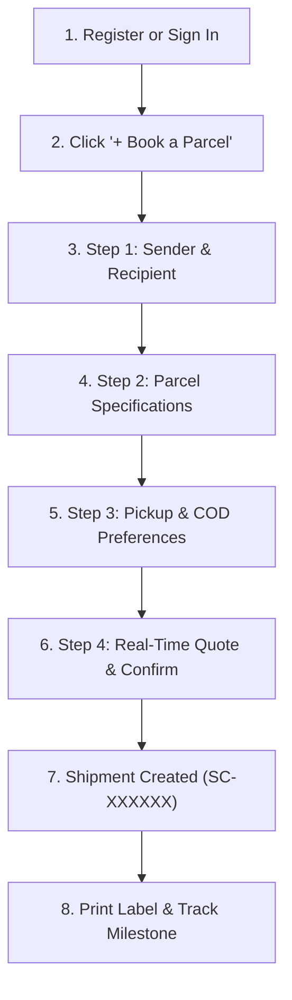

# Comprehensive Operational User Journeys (8 Distinct Paths)

**Project:** Smart Courier & Parcel Delivery Management System  
**Framework:** Flask 3.1 + SQLAlchemy 2.0 (SQLite Engine)  
**UX Paradigm:** Inspired by the operational convenience of TCS Express & Daraz Logistics (Original Smart Courier Implementation).

---

## 1. Journey 1: Customer Self-Service Consignment Journey

### Persona: Usman Malik (Registered Merchant / Individual Shipper)
- **Goal:** Book a 650g parcel from Lahore to Karachi with Cash on Delivery (COD) collection, schedule a doorstep pickup, print the barcode waybill, and track delivery milestones.

### Step-by-Step Execution:
1. **Authentication:** Customer visits `/auth/login` or creates an account via `/auth/register`. The system validates email, sets PBKDF2 hash, and automatically binds a unique `Customer` record (`CUST-0009`).
2. **Dashboard Landing:** Customer lands on **"My Parcels"** dashboard. Sees personal parcel counters (Total, In Transit, Delivered, Action Needed) and clicks **"+ Book a Parcel"**.
3. **Step 1 (Sender & Recipient):** Sender details auto-fill from the customer profile. Customer selects destination city (Karachi, Zone 2), enters Babar Azam's contact, and checks *"Save this recipient"*.
4. **Step 2 (Parcel Specifications):** Selects "Electronics", enters 650 grams weight and declared value of PKR 5,000.
5. **Step 3 (Pickup & COD):** Selects "Doorstep Pickup" (Morning Window: 09:00 - 13:00) and enters PKR 3,500 Cash on Delivery (COD) to collect from the recipient.
6. **Step 4 (Review & Confirm):** System dynamically calculates the shipping charge (PKR 350.00 base freight + PKR 50.00 packaging = PKR 400.00 Total). Customer clicks **"Confirm & Book Shipment"**.
7. **Success Confirmation:** Redirects to `/shipments/<id>`. Displays generated tracking number `SC2611-LHR-XXXXX`, printable waybill label with barcode, and linked billing invoice.

---

## 2. Journey 2: Booking Counter Agent Journey

### Persona: Ayesha Khan (Lahore Booking Counter Agent)
- **Goal:** Accept an over-the-counter walk-in package, look up or register a walk-in customer, weigh the parcel, generate a counter receipt, and intake the consignment.

1. **Sign In:** Agent logs in at `/auth/login` as `booking.lahore@smartcourier.pk`.
2. **Customer Selection:** Navigates to `/shipments/new`. Agent is presented with the **Staff Desk Selection** card and selects the customer account from the dropdown.
3. **Routing Verification:** System derives the origin branch (`Lahore Central Branch`) and sets destination branch from recipient zone.
4. **Physical Inspection:** Agent verifies weight on certified scale, records parcel category, and issues the official booking confirmation.
5. **Print Counter Receipt:** Agent clicks **"Print Consignment Label"** (`/shipments/<id>/label`) to print the two-part label (Package Waybill + Shipper Copy).

---

## 3. Journey 3: Hub Sorting Operator Journey

### Persona: Bilal Ahmed (Lahore Mega Sorting Facility Operator)
- **Goal:** Scan arriving parcels into sorting hub, sort by destination city, and initiate secure inter-hub linehaul freight transfer to Karachi Coastal Hub.

1. **Inbound Parcel Scan:** Hub operator opens `/hubs/scans` and scans parcel barcode `SC2611-LHR-XXXXX`.
2. **Automated State Update:** The system checks that the parcel is in `PICKED_UP` or `BOOKED` status, updates `shipment_status` to `AT_ORIGIN_HUB`, records a physical `ShipmentScan`, and writes a public `TrackingEvent` ("Parcel received and scanned at origin sorting hub").
3. **Linehaul Freight Transfer:** Operator opens `/hubs/transfers`. Selects destination hub (`Karachi Coastal Hub`) and selects eligible sorted parcels.
4. **Transfer Dispatch:** Clicks **"Dispatch Freight Transfer"**. The shipment status advances to `IN_TRANSIT` with manifest code `TRF-LHR-KHI-XXXX`.
5. **Destination Receipt:** Upon container arrival at Karachi Coastal Hub, the Karachi hub operator scans the shipment, advancing status to `AT_DESTINATION_HUB`.

---

## 4. Journey 4: Logistics Dispatcher Journey

### Persona: Hamza Ali (Logistics Dispatcher)
- **Goal:** Sequence delivery stops for the destination service zone and dispatch the delivery runsheet to a field driver.

1. **Dispatch Planning:** Dispatcher visits `/dispatch/routes`. Clicks **"Create Delivery Route"**, selects vehicle `LES-1122` (Suzuki Every Van), driver Kamran Akram (`driver1@smartcourier.pk`), and sets route date.
2. **Stop Sequencing:** Opens route detail. Searches parcels sorted at destination hub (`AT_DESTINATION_HUB`).
3. **Prerequisite Enforcement:** System strictly enforces that only parcels physically received at the destination hub (or failed attempts being retried) can be added to delivery stops. Adding `IN_TRANSIT` parcels is rejected with a clear message.
4. **Runsheet Release:** Dispatcher adds stop sequence #1 for Babar Azam in DHA Phase 5. Shipment status automatically advances to `OUT_FOR_DELIVERY`.

---

## 5. Journey 5: Delivery Driver Journey

### Persona: Kamran Akram (Delivery Driver)
- **Goal:** Inspect today's assigned delivery stops, navigate to recipient address, collect Cash on Delivery (COD), record digital proof of delivery, and complete the stop.

1. **Workspace Access:** Driver logs in on mobile device at `/driver/my-runs`.
2. **Stop Inspection:** Driver views active stops for vehicle `LES-1122`. Stop #1 displays recipient address, phone number, and COD collection amount: **PKR 3,500**.
3. **Recipient Handover:** Driver arrives at destination. Recipient inspects package integrity and hands over PKR 3,500 cash.
4. **Proof of Delivery Recording:** Driver clicks **"Record Delivery"** (`/driver/attempts`).
   - Outcome: `SUCCESS`
   - Recipient Name: "Babar Azam"
   - Confirmation: Signature / OTP Verified
5. **Atomic Finalization:** System atomically:
   - Sets `shipment_status` to `DELIVERED`.
   - Records `DeliveryAttempt` and `DeliveryProof`.
   - Creates a pending `CodCollection` record for PKR 3,500.
   - Writes public milestone: *"Parcel successfully delivered to recipient"*.

---

## 6. Journey 6: Finance Officer Journey

### Persona: Saima Farooq (Finance Officer)
- **Goal:** Reconcile cash collected by courier drivers, record freight invoice settlement, and remit COD funds to merchant.

1. **Invoice Audit:** Finance officer visits `/finance/invoices`. Filters by unpaid invoices (`ISSUED`).
2. **Freight Payment Recording:** Opens invoice for consignment `SC2611-LHR-XXXXX`. Customer pays shipping charge of PKR 400.00 via counter cash. Officer records payment; invoice balance recalculates to PKR 0.00 and status updates to `PAID`.
3. **COD Collection Reconciliation:** Officer navigates to `/finance/cod`. Verifies driver Kamran Akram deposited the collected PKR 3,500 cash at the branch cashier.
4. **Merchant Remittance:** Officer opens `/finance/cod` and clicks **"Remit to Merchant"** for Usman Malik's account. System records `CodRemittance`, issues transfer reference, and updates status to `REMITTED`.
5. **Refund Processing:** If a customer requests a shipping fee refund prior to dispatch, officer clicks **"Process Refund"** on the invoice. System reverses the payment, creates an audit log, and reopens the invoice to `ISSUED`.

---

## 7. Journey 7: Customer Support Agent Journey

### Persona: Zainab Bibi (Customer Support Agent)
- **Goal:** Resolve a customer delivery inquiry, reply to customer ticket, and maintain private internal communications.

1. **Ticket Queue:** Agent visits `/support/tickets`. Views open customer inquiries.
2. **Customer Ticket Inspection:** Opens ticket `#TICK-2611-001` submitted by Usman Malik regarding delivery time window.
3. **Internal Note:** Agent posts an internal note (*"Driver Kamran confirmed arrival at 11:30 AM"*) with checkbox `is_internal = True`. System strictly isolates this note so it is invisible to the customer.
4. **Public Customer Reply:** Agent posts a customer-facing reply informing the merchant of the estimated arrival.
5. **Ticket Closure:** Upon successful resolution, agent closes the ticket.

---

## 8. Journey 8: Super Administrator Journey

### Persona: Tariq Mahmood (Super Administrator)
- **Goal:** Maintain enterprise organizational topology, manage branches, inspect system-wide audit logs, and oversee operational health.

1. **Executive Dashboard:** Admin signs in as `admin@smartcourier.pk`. Views enterprise-wide aggregates, active branches, total volume, and revenue.
2. **Topology Management:** Visits `/admin/branches` and `/admin/hubs`. Configures new regional sorting facilities and coverage zones.
3. **Staff & RBAC:** Visits `/admin/users`. Provisions staff accounts, assigns roles, and manages operational branches.
4. **Immutable Audit Trail:** Visits `/admin/audit-logs`. Inspects immutable system log entries capturing user ID, timestamp, before/after JSON states, and IP addresses. Non-admin users attempting to open this endpoint are rejected with HTTP 403.
